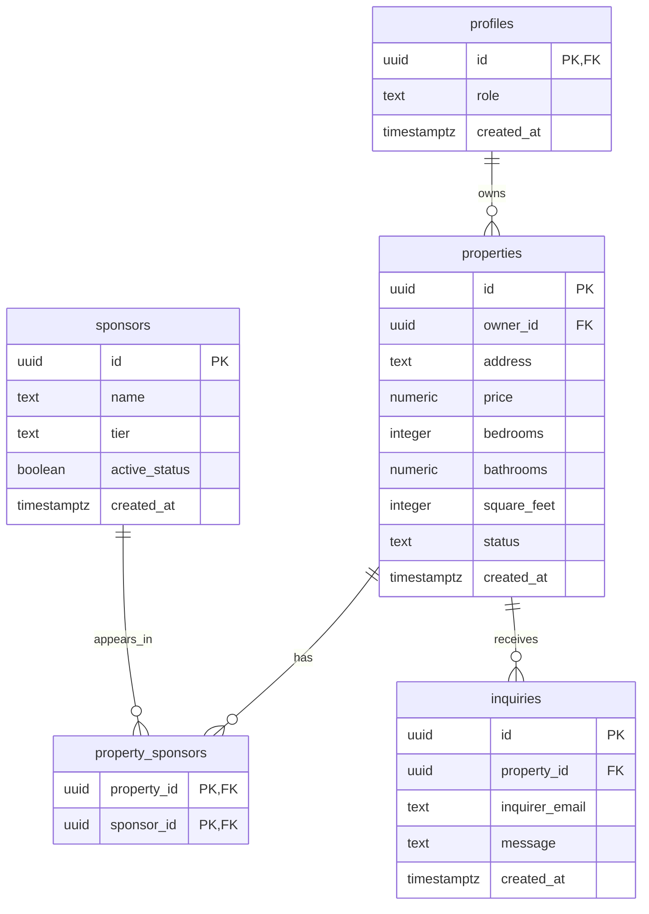

# Lab 5: Database relationships and schema review

This documents the existing exam database being reused for Lab 5. It is a source review, not a claim that a new migration or test has run. The starting snapshot is commit `e0cb2e3`.

Authoritative SQL:

- [Initial schema and RLS](../supabase/migrations/20261029140000_exam_schema_persistence.sql)
- [Subsequent security hardening](../supabase/migrations/20261029150000_exam_security_hardening.sql)

Read both migrations in order: the second replaces several policies and table grants. Do not edit or rerun the original `CREATE TABLE` statements against the already-configured project. Accepted Lab 5 changes belong in a new migration.

## Relationship drawing

`PK` means primary key, a unique identifier. `FK` means foreign key, a reference to another table. A single bar pair denotes exactly one parent; the circle and crow's foot denote zero or many children.

`profiles.id` also references Supabase's existing `auth.users.id`. That managed authentication table is outside these five application tables. A profile uses the authenticated account's UUID; it does not generate an unrelated ID.

## What each relationship means

| Relationship | Meaning |
| --- | --- |
| `profiles` to `properties` | A profile can own zero or many listings. Every property must reference exactly one existing profile. RLS additionally checks that ordinary owners have the `property_owner` role. |
| `properties` to `property_sponsors` | A property can have zero or many sponsor connections. |
| `sponsors` to `property_sponsors` | A sponsor can appear alongside zero or many properties. The linking table implements this many-to-many relationship. |
| `properties` to `inquiries` | A property can receive zero or many inquiries; each inquiry references one existing property. |

The same property/sponsor pair cannot be connected twice because both IDs together form the linking table's primary key. Sponsors have no `owner_id` or approval-status column in this schema; current sponsor management belongs to administrators, not a sponsor self-service workflow.

## Keys, required fields, checks, and timestamps

| Table | Key and required values | Checks and defaults actually declared |
| --- | --- | --- |
| `profiles` | `id` is a UUID primary/foreign key. `role` and `created_at` are required. | Role is `admin`, `property_owner`, `sponsor`, or `public`. Creation timestamp defaults automatically. |
| `properties` | UUID primary key; required profile owner, address, price, bedrooms, bathrooms, square feet, status, and creation timestamp. | Price is `numeric(12,2)` and at least zero. Bedrooms are a nonnegative integer. Bathrooms are `numeric(3,1)` and at least zero. Square feet is a positive integer. Status is `draft`, `pending`, `approved`, or `rejected`, defaulting to `draft`. ID and creation timestamp default automatically. |
| `sponsors` | UUID primary key; required name, tier, active flag, and creation timestamp. | Name is at least two characters. Tier is `gold`, `silver`, or `bronze`. Active flag defaults to true. ID and creation timestamp default automatically. |
| `property_sponsors` | Composite primary key of property UUID and sponsor UUID; each is also a foreign key. | Primary-key membership makes both columns non-null even without a separate `NOT NULL` clause. No timestamp column is declared here. |
| `inquiries` | UUID primary key; required property UUID, email, message, and creation timestamp. | Email must match the SQL pattern in the migration. Message must be at least ten characters. ID and creation timestamp default automatically. |

The four entity tables use `timestamptz` and the existing `timezone('utc'::text, now())` default. The source does not define `updated_at`; do not describe creation timestamps as edit timestamps. Review the timestamp default's behavior if using a database session with a non-UTC timezone.

Database checks complement the existing [AJV property input schema](../src/schemas/property.ts). They are not identical: the API rejects blank/short/overlong addresses, but the database currently requires only non-null address text. The numeric database columns also have fixed decimal precision; the API does not explicitly require matching decimal increments. Review whether direct writes need aligned checks or whether rounding is an intentional decision.

## Deletion and cascade review

| Deleted parent | Current foreign-key behavior | Practical effect |
| --- | --- | --- |
| Auth user | `profiles.id`: `ON DELETE CASCADE` | Attempts to remove the matching profile. If that profile still owns properties, the following restriction can block the entire deletion. |
| Profile | `properties.owner_id`: `ON DELETE RESTRICT` | A profile owning listings cannot be deleted until ownership/listings are handled deliberately. |
| Property | Both related foreign keys use `ON DELETE CASCADE` | Deletes the property's sponsor-link rows and inquiry rows. It does not delete sponsor businesses. |
| Sponsor | `property_sponsors.sponsor_id`: `ON DELETE CASCADE` | Deletes the sponsor's link rows. It does not delete properties. |

Foreign keys describe what happens after a deletion is authorized. They do not grant permission to delete. The inquiry cascade is significant: deleting a listing also deletes its associated messages, so the allowed actor and listing state must be reviewed together.

## Existing access plan after both migrations

| Actor | Current access relevant to this design |
| --- | --- |
| Anonymous visitor | Reads approved properties, active sponsors, and visible sponsor links. Can insert an inquiry, subject to SQL constraints. Has no inquiry SELECT grant. |
| Authenticated property owner | Reads their own listings as well as public listings; inserts their own draft. Updates only their own `draft` or `rejected` records, with the ownership/status/role predicates checked on both the old and new row. Can read inquiries for properties they own. |
| Other ordinary authenticated user | Public listing/sponsor access remains available. Ownership policies do not grant access to another owner's drafts or mutations. |
| Authenticated administrator | Uses `is_exam_admin()` and per-table administrator policies. The helper checks the caller's profile role. The normal POST route also verifies the authenticated profile before creating a draft. |
| Trusted service role | Has privileged access that bypasses RLS. Keep its key server-only. Its success cannot establish whether ordinary-user RLS works. |

## Decisions to take to the required AI review

These findings are based on source inspection. They are not newly executed exploitation tests.

1. **Approved listing deletion:** `properties_owner_delete_own` has owner and role checks but no status check. It currently permits an owner to delete an approved listing, including its inquiry cascade. Propose a narrow follow-up policy consistent with the lab's unapproved-only owner mutation rule.
2. **Submitted records:** owner UPDATE currently allows `draft` and `rejected`, not `pending`. Keep the distinction explicit: being unapproved does not automatically mean a submitted record should remain editable. Do not broaden permissions without a stated requirement.
3. **Inquiry targets:** the public INSERT policy uses `WITH CHECK (true)`. Its foreign key checks existence, not public approval. Decide whether ordinary inquiries should be restricted to approved properties; retain deliberately separate administrator authority if needed.
4. **Validation alignment:** inspect nonblank text checks, numeric precision, and timestamps. Prioritize concrete inconsistencies over adding fields or arbitrary business rules.
5. **Defensive tests:** explicitly attempt ownership reassignment, self-approval, cross-owner writes, anonymous property writes, and profile role escalation. Assert the actual denial mechanism and unchanged protected rows. Do not accept an unrelated connection/schema error as a security pass.

The review input is prepared in [lab5-ai-review-prompt.txt](lab5-ai-review-prompt.txt). The student supplied the real external review in chat. Its assessment is recorded below; the student identified the model as Gemini Flash-Lite (exact version not supplied). The follow-up migration was subsequently applied by the student, its saved DELETE predicate verified, and its role behavior checked in the uploaded 23-check live audit evidence. See `lab5-database-verification.md` and `security-audit.md`.

## External AI review: accepted, adapted, and rejected

The student supplied the external response in the Lab 5 conversation. The student subsequently identified the model as Gemini Flash-Lite; the exact version was not supplied. The exact review input remains in `lab5-ai-review-prompt.txt`. This records our assessment, not a claim that Gemini's SQL/tests were executed.

| Recommendation or claim | Decision and reason |
| --- | --- |
| Owners should delete only their own draft/rejected listings. | **Accepted.** This closes the identified approved/pending deletion gap. The response calls it both a defect and optional; for this lab we treat it as a required correction to the owner mutation boundary. |
| Drop/recreate the DELETE policy. | **Adapted.** The new migration uses `ALTER POLICY ... USING` to retain the policy's existing DELETE command and authenticated role while changing only its predicate. It retains the ownership and profile-role checks. |
| Reject unexpected errors in the security test helper. | **Accepted in principle, helper adapted later.** The proposed replacement rejects every database error, including genuine expected `42501` permission failures. Tests must distinguish an expected exact error code from an expected empty result, reject all unrelated errors, and prove protected data stayed unchanged. |
| `WITH CHECK (true)` is necessary for anonymous inquiry submission. | **Rejected as stated.** Anonymous submission is controlled by grants and policies addressed to `anon`; its row predicate can still restrict target properties. We retain the existing behavior for now because changing inquiry target rules is a separate product decision not explicitly required by this lab. Current policy does not enforce approval of the inquiry's target. |
| Four-role matrix. | **Incomplete.** It omits Other Authenticated User, substitutes separate Admin and Service rows, and gives no denied admin operation. Final matrix must contain anon, resource owner, other authenticated user, and administrator. A negative-price write can demonstrate an admin/service constraint denial; it is not an RLS denial. A proper owner self-approval test starts with an owned draft and attempts to change its status to approved. |
| Seed with fixed placeholder profile UUIDs. | **Rejected as runnable seed.** These IDs are foreign keys to `auth.users`; they must match existing development accounts. The proposed seed also lacks Owner B, sponsor links, inquiries, and denied-visibility fixtures. `ON CONFLICT DO NOTHING` is not proof that an existing fixture has the expected state. |
| Stop Supabase, then reset. | **Rejected as supplied.** The default local `db reset` requires a running initialized local stack; this repository snapshot has no `supabase/config.toml`. Do not use reset against the existing hosted exam project. Choose a clean disposable environment and document its prerequisites before rebuild verification. |
| General claims that keys/checks are all adequate. | **Qualified.** Profile IDs come from Auth rather than a UUID default; square feet must be greater than zero, not merely nonnegative; an email regex is not full email verification. Decimal rounding, text checks, and timestamp behavior remain explicit review items. |

### Step 4 original draft and subsequent verification

[20261103000000_lab5_owner_delete_unapproved.sql](../supabase/migrations/20261103000000_lab5_owner_delete_unapproved.sql) changes only the owner's DELETE policy. Prior migrations remain unchanged. Pending verification must include an owner successfully deleting an expendable draft/rejected fixture, zero-row deletion for an approved/pending fixture, cross-owner denial, and a trusted read confirming denied targets and related inquiry/link records remain intact.

The existing UPDATE lock on pending/approved records is retained. Public inquiry policy, validation contracts, application code, and credentials are unchanged in this draft. That describes the original draft scope. Subsequently, the student applied this saved migration and provided its policy definition and 23-check passing live evidence with verified fixture restoration. Earlier migrations remain unchanged.

### Official verification references

- PostgreSQL `ALTER POLICY`: https://www.postgresql.org/docs/current/sql-alterpolicy.html
- Supabase RLS and policy test semantics: https://supabase.com/docs/guides/database/postgres/row-level-security
- Supabase CLI reset prerequisites: https://supabase.com/docs/reference/cli/supabase-db-reset

### Filename decision resolved

The student resumed with the original numbered filename. The active draft is `20261103000000_lab5_owner_delete_unapproved.sql`, preserving Supabase CLI compatibility and the lab requirement. The unnumbered download is superseded.

## Clean schema reconstruction verified

The student subsequently applied all three saved migrations to the separate empty hosted project `neighborhood-lab5-rebuild`. All executions succeeded. The supplied catalog query showed five RLS-enabled tables, 16 policies, and the final owner-delete predicate. Exact results and the distinction from the original development project's role audit are in [lab5-rebuild-evidence.md](lab5-rebuild-evidence.md).
